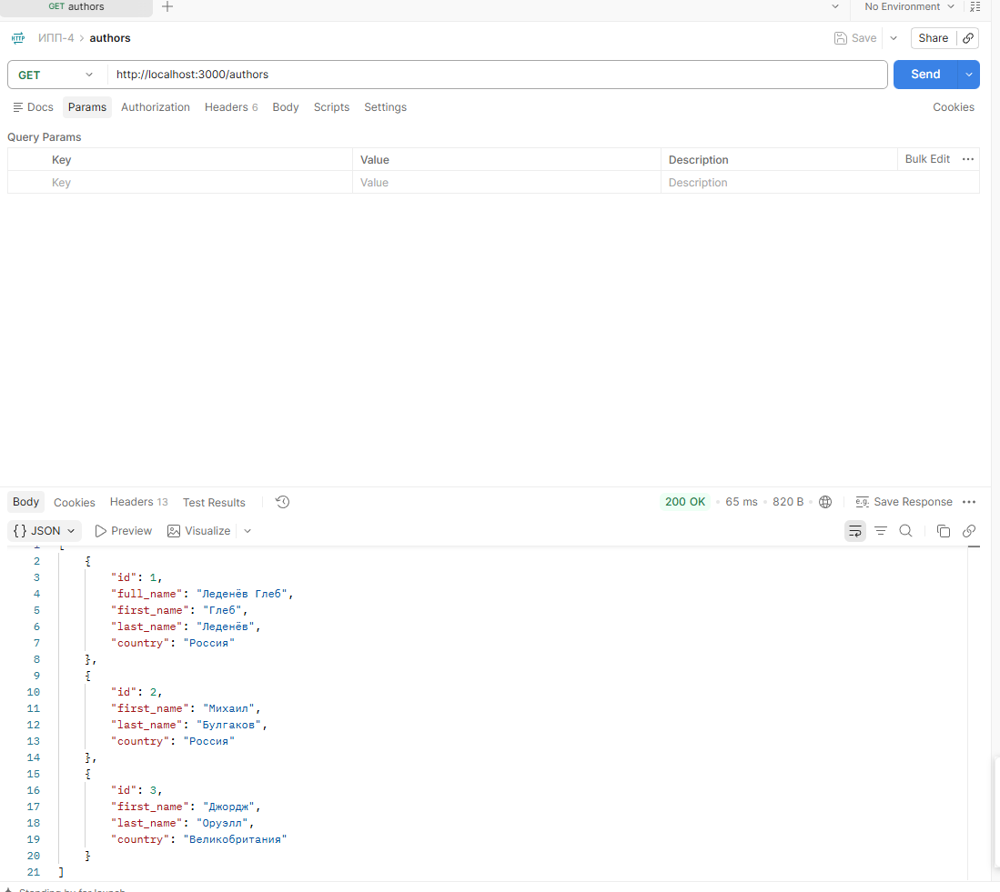
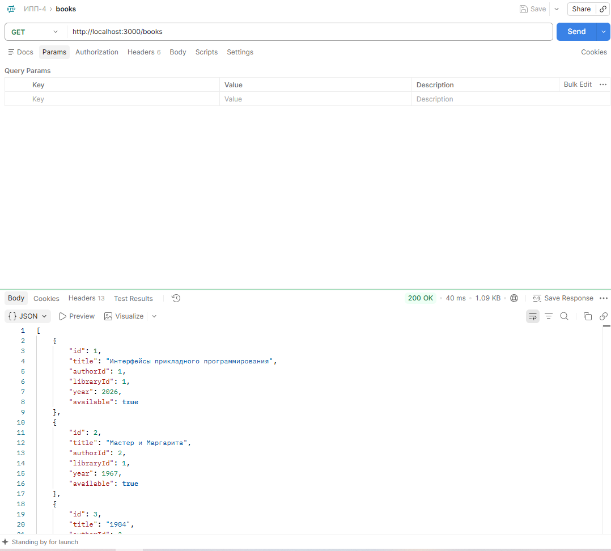
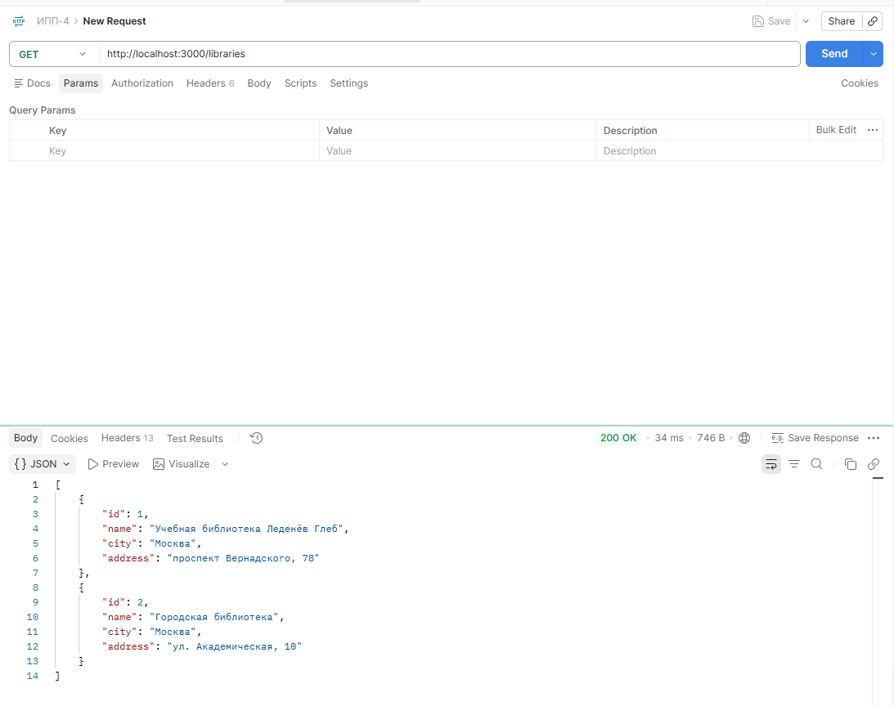
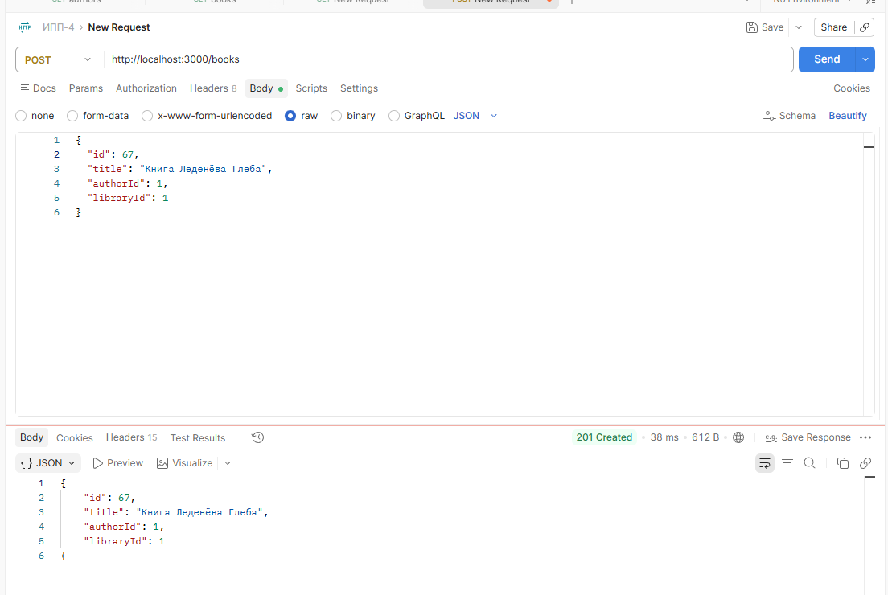
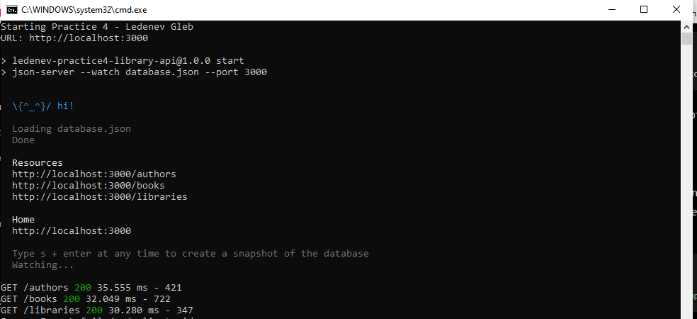
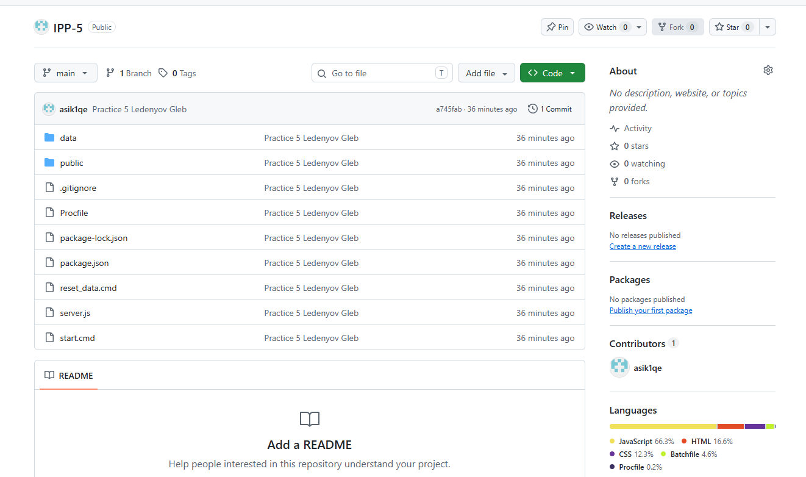
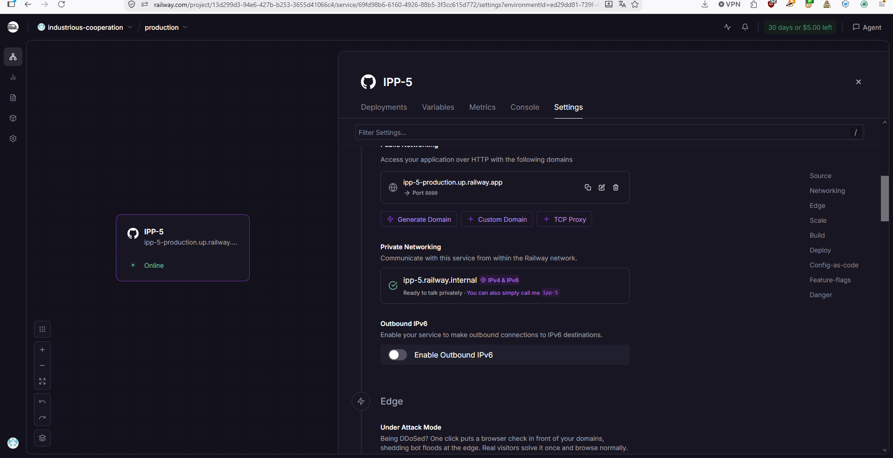
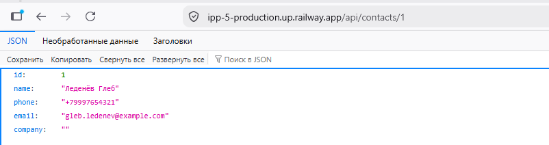
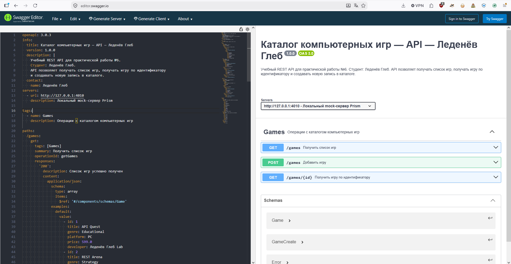
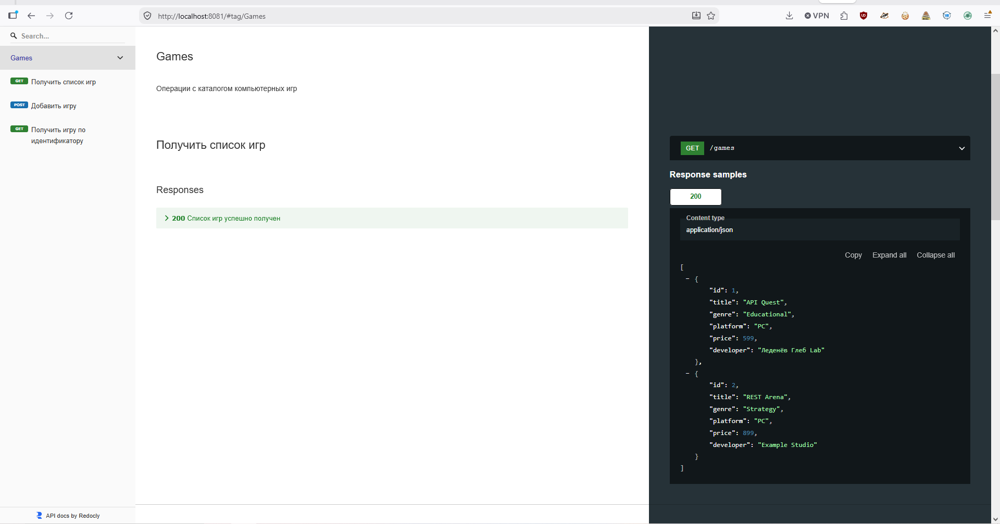

# Практические работы № 4–6 по дисциплине «Интерфейсы прикладного программирования»

**Выполнил: Леденёв Глеб**

---

## Практическая работа № 4  
### Создание простейшего имитационного REST API с помощью NodeJS

### Цель работы

Создать локальный имитационный REST API с помощью **NodeJS** и **json-server**, организовать ресурсы для авторов, книг и библиотек, а также проверить работу API HTTP-запросами.

### Ход работы

Для выполнения работы был создан файл `database.json`, содержащий три ресурса:

- `authors` — авторы;
- `books` — книги;
- `libraries` — библиотеки.

Сервер был запущен локально на порту `3000`:

```text
http://localhost:3000
```

После запуска API его работа была проверена в **Postman**.

#### Получение списка авторов

```http
GET http://localhost:3000/authors
```



#### Получение списка книг

```http
GET http://localhost:3000/books
```



#### Получение списка библиотек

```http
GET http://localhost:3000/libraries
```



#### Добавление новой книги

```http
POST http://localhost:3000/books
```

Пример тела запроса:

```json
{
  "title": "Книга Леденёва Глеба",
  "authorId": 1,
  "libraryId": 1
}
```



#### Запущенный сервер



### Вывод

В ходе работы был создан и запущен имитационный REST API. Были проверены операции получения данных и добавления новой записи. На практике было показано взаимодействие клиента с REST API через HTTP-запросы и использование Postman для тестирования.

---

## Практическая работа № 5  
### Проектирование и реализация REST API (CRUD APP)

### Цель работы

Разработать REST API для управления списком телефонных контактов, реализовать основные **CRUD-операции** и развернуть приложение на удалённом сервере.

### Ход работы

Приложение создано на **NodeJS** с использованием **Express**. Для работы со списком контактов реализован ресурс:

```text
/api/contacts
```

Поддерживаются основные CRUD-операции:

```http
GET    /api/contacts
GET    /api/contacts/:id
POST   /api/contacts
PUT    /api/contacts/:id
DELETE /api/contacts/:id
```

Пример данных контакта:

```json
{
  "name": "Леденёв Глеб",
  "phone": "+79991234567",
  "email": "gleb.ledenev@example.com"
}
```

Исходный код приложения был размещён в репозитории **GitHub**.



После этого приложение было развёрнуто на облачной платформе **Railway**, благодаря чему REST API стал доступен по публичному адресу.



Работа удалённого API была проверена обращением к опубликованному ресурсу.



### Вывод

В результате был реализован REST API для телефонных контактов с поддержкой операций создания, чтения, изменения и удаления данных. Приложение было опубликовано на Railway и стало доступно через интернет независимо от локального компьютера.

---

## Практическая работа № 6  
### Создание и документирование API на основе OpenAPI

### Цель работы

Изучить спецификацию **OpenAPI** и инструменты для проектирования, документирования и имитации REST API: **Swagger Editor**, **ReDoc** и **Prism**.

### Ход работы

В качестве предметной области был выбран **каталог компьютерных игр**.

Для API был создан файл спецификации `openapi.yaml`, в котором описаны основные конечные точки:

```http
GET  /games
POST /games
GET  /games/{id}
```

Также в спецификации определены структуры данных, параметры запросов и возможные ответы сервера.

#### Проверка спецификации в Swagger Editor

Файл `openapi.yaml` был открыт в **Swagger Editor**. Слева отображается YAML-описание API, справа — автоматически сформированное представление доступных методов и схем.



#### Документация ReDoc

На основе той же OpenAPI-спецификации была сформирована документация с помощью **ReDoc**.



Для имитации работы API используется **Prism**, который запускает mock-сервер на основе описанного в `openapi.yaml` контракта. После запуска его можно тестировать через Postman.

Пример адреса mock-сервера:

```text
http://127.0.0.1:4010
```

Пример запроса:

```http
GET http://127.0.0.1:4010/games
```

### Вывод

В ходе работы была создана спецификация REST API в формате OpenAPI. Swagger Editor использован для проверки и просмотра контракта API, ReDoc — для формирования документации, а Prism — для запуска имитационного сервера. Один файл `openapi.yaml` используется как единое описание структуры и поведения API.
